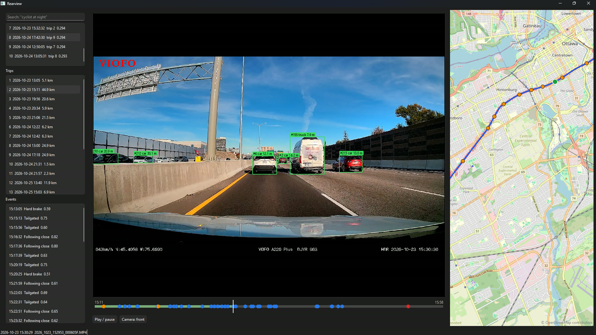
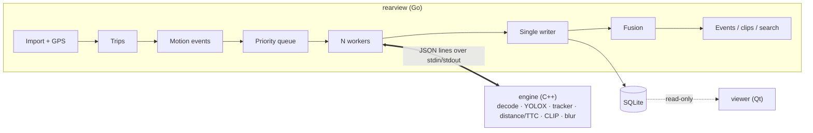

# Rearview

Rearview turns hours of dashcam footage into a searchable list of real driving events (hard braking, close following, tailgating, near-misses), with clips, incident reports and plain-English search. A concurrent Go orchestrator schedules the work; a C++ vision engine runs object detection, tracking and CLIP on the GPU.



_The desktop viewer: tracked vehicles with distance over the front camera, the trip's events on the timeline (orange = hard brake, blue = following close / tailgated, red = near-miss) and in the list, search results top left, and the route with event pins on the map._

|                          |                                                                                                        |
| ------------------------ | ------------------------------------------------------------------------------------------------------ |
| **Speed**                | 1 hour of 2560×1440 footage analysed in **2.4 minutes** (RX 9070 XT, DirectML; 28 min on the CPU)      |
| **Hard-brake detection** | precision 1.00, recall 1.00 (9 of 9 labelled brakes in 4.2 h; labels still to be owner-reviewed)       |
| **Search**               | right moment in the top 5 for 5 of 24 drafted queries (21%; 5.35 h of front footage, 19,266 keyframes) |

Near-miss and following-distance detection run end to end but have no accuracy numbers yet: they need labelled events and a camera calibration ([limitations](#limitations)).

## Try it

No dashcam, GPU or C++ toolchain needed. Each option runs on three 20-second sample clips.

| Time        | How                                                                                                                                                                    |
| ----------- | ---------------------------------------------------------------------------------------------------------------------------------------------------------------------- |
| ~5 min      | **Prebuilt download.** Get `rearview-windows-x64.zip` or `rearview-linux-x64.tar.gz` from [Releases](https://github.com/ousmanebarry/rearview/releases/latest), extract it and run the quickstart (below) |
| ~10 min     | **In the browser.** [](https://codespaces.new/ousmanebarry/rearview?quickstart=1), wait for setup to finish, then `bash scripts/quickstart.sh` |
| ~30 s       | **Just the orchestrator.** `cd go && go test ./...` runs import, the job queue, worker pool, crash recovery and event fusion against a fake engine (`go/cmd/fakeengine`) |

```powershell
powershell -ExecutionPolicy Bypass -File quickstart.ps1     # Windows (needs ffmpeg: winget install Gyan.FFmpeg)
./quickstart.sh                                             # Linux   (needs ffmpeg: sudo apt install ffmpeg)
```

The quickstart downloads the models (about 615 MB, checksums verified) and the sample clips once, imports the clips into `~/rearview-demo`, then runs detection, tracking, distance and TTC, indexes keyframes for search and searches for "a traffic light". It also writes `~/rearview-demo/boxes.mp4`, the first clip with every tracked object drawn on it. On a laptop CPU this takes a few minutes. The clips carry no GPS, so speed-based events (hard brakes, following distance) stay empty. Afterwards, try `rearview search "<anything>" --config ~/rearview-demo/config.yaml`.

The Windows download is the DirectML build. It runs on the CPU by default; add `--device dml` (or set `engine.device: dml`) to use a DirectX 12 GPU. Releases are built by [.github/workflows/release.yml](.github/workflows/release.yml) when a `v*` tag is pushed.

## Contents

- [Try it](#try-it)
- [What it does](#what-it-does)
- [Setup](#setup)
- [Using it](#using-it)
- [How it works](#how-it-works)
- [Results](#results)
- [Development](#development)
- [Troubleshooting](#troubleshooting)
- [Limitations](#limitations)
- [Documentation](#documentation)

## What it does

- **Imports** recordings from the SD card into a dated library (crash-safe copies, duplicates skipped) and decodes the GPS the camera hides inside each MP4.
- **Builds trips**: pairs front and rear files, corrects the camera clock from GPS, fills short GPS gaps, exports GPX.
- **Finds motion events** from GPS alone (hard brakes, swerves) and analyses those moments first.
- **Detects and tracks** cars, trucks, buses, people, bikes and traffic lights on the GPU, with distance and time-to-collision (TTC) per tracked object.
- **Flags** near-misses (TTC under 1.5 s), following too close (under 1 s behind at 50+ km/h) and being tailgated (the same on the rear camera).
- **Cuts clips** in under a second, **exports** shareable clips with faces and plates blurred, and writes **one-page incident PDFs**.
- **Searches** the footage in plain English ("a cyclist at night") with CLIP.
- **Scores** each trip, explaining every point lost, with a weekly trend.
- **Benchmarks** itself (`rearview bench`) and **evaluates** itself against your labels (`rearview eval`).
- An optional **desktop viewer** shows all of it on a video player, timeline and map.

It was built for a VIOFO A229 Plus (2560×1440 front and rear, 3-minute loop files) on Windows 11 with an AMD GPU. File-name patterns, time zone and thresholds are all in the config file, and the CPU build runs anywhere, but the GPS decoder only understands the VIOFO "freeGPS" format.

## Setup

### 1. Requirements

| What                                                   | Notes                                                                                                                                    |
| ------------------------------------------------------ | ---------------------------------------------------------------------------------------------------------------------------------------- |
| Windows 11 x64                                         | Linux works for the CLI and the CPU engine (CI builds both), but the setup script, DirectML and the viewer are Windows-only               |
| Go 1.27+                                               | The CLI (pure Go, no C compiler needed)                                                                                                  |
| Visual Studio 2022 (or Build Tools), "Desktop development with C++" | The engine and the viewer (C++20)                                                                                         |
| CMake 3.26+ and [vcpkg](https://github.com/microsoft/vcpkg) | `VCPKG_ROOT` must point at the vcpkg folder; vcpkg builds OpenCV, FFmpeg and Qt from source the first time                          |
| Git with Git LFS                                       | The three 20-second test clips are in LFS                                                                                                |
| ffmpeg and ffprobe on `PATH`                           | Import (probing), clips, exports                                                                                                         |
| exiftool (optional)                                    | Only to regenerate the GPS golden files                                                                                                  |
| A DirectX 12 GPU (optional)                            | For the DirectML build; developed on an RX 9070 XT. Without one, use the CPU build (about 12× slower)                                      |
| Disk                                                   | About 650 MB per 3-minute 1440p recording, plus ~10 GB for vcpkg build trees                                                             |

### 2. Get the code and the tools

```powershell
git lfs install
git clone https://github.com/ousmanebarry/rearview.git
cd rearview

# Installs anything missing with winget (Go, Git LFS, VS Build Tools, CMake, vcpkg, ffmpeg, exiftool)
# and prints every version. Run from an elevated PowerShell; -CheckOnly only reports.
powershell -ExecutionPolicy Bypass -File scripts\setup-windows.ps1
```

Open a new terminal afterwards so `PATH` and `VCPKG_ROOT` are picked up. Check with `go version`, `cmake --version`, `ffmpeg -version` and `echo $env:VCPKG_ROOT`.

### 3. Download the models

```powershell
cmake -P engine/scripts/download_models.cmake
```

This fetches YOLOX-s, the CLIP ViT-B/32 image and text encoders with the tokenizer files, and YuNet into `engine/models/` (about 615 MB), checking each file's SHA-256. The engine finds `engine/models/` on its own; set `engine.models_path` in the config if you keep them elsewhere. Once the CLI is built (step 5), `rearview models download` does the same, and `rearview models` shows which files are missing.

### 4. Build the engine

Pick one preset:

| Preset    | Inference                                              | Use when                                                     |
| --------- | ------------------------------------------------------ | ------------------------------------------------------------ |
| `dev-dml` | ONNX Runtime with DirectML (GPU), falls back to CPU    | You have a DirectX 12 GPU (AMD, NVIDIA or Intel)             |
| `dev`     | ONNX Runtime on the CPU                                | No suitable GPU, or to compare                               |

```powershell
cd engine
cmake --preset dev-dml        # first run: vcpkg builds OpenCV + FFmpeg (~20–30 min); ONNX Runtime is downloaded
cmake --build --preset dev-dml
ctest --test-dir build/dev-dml -C RelWithDebInfo     # 57 tests; for the CPU build: ctest --preset dev
build/dev-dml/RelWithDebInfo/engine.exe info --device dml
cd ..
```

`engine info` prints the versions, the available execution providers (`DmlExecutionProvider` for the GPU build) and each model's input and output shapes. The engine binary ends up in `engine/build/<preset>/RelWithDebInfo/engine.exe`.

### 5. Build the CLI

```powershell
cd go
go build -o bin/rearview.exe ./cmd/rearview
go test ./...
cd ..
```

Put `go/bin` on your `PATH` (or call it by its full path). In Git Bash: `export PATH="$PATH:/c/path/to/rearview/go/bin"`.

### 6. Configure

Rearview reads `~/rearview/config.yaml` (`--config <file>` to use another). Every setting has a default, so the file only needs what differs. At minimum, point it at the engine:

```yaml
# ~/rearview/config.yaml
engine:
  path: C:/path/to/rearview/engine/build/dev-dml/RelWithDebInfo/engine.exe
  device: dml          # cpu for the dev build
  workers: 2           # engine processes in parallel; 2 was fastest on a 16-thread CPU

# Optional: where things live (defaults shown)
# library_path: ~/rearview/library     # imported recordings, YYYY/MM/DD/
# database_path: ~/rearview/rearview.db
# clips_path: ~/rearview/clips         # clips, exports, PDFs, GPX
# time_zone: America/New_York          # the camera clock's zone (file names are local time)
```

`rearview config show` prints the full effective configuration: library paths, file-name patterns for front/rear/interior files, every detection threshold, search and scoring settings. A different camera that names files differently needs `import.front_pattern`, `import.rear_pattern`, `import.time_pattern` and `import.time_layout` adjusted.

### 7. (Optional) Build the desktop viewer

```powershell
cd viewer
cmake --preset dev                 # first run: vcpkg builds Qt 6 base + multimedia (~15 min)
cmake --build --preset dev
build/dev/RelWithDebInfo/viewer.exe --rearview C:/path/to/rearview/go/bin/rearview.exe
```

Options: `--db` and `--library` (default to `~/rearview/...`), `--rearview` (the CLI used by the search box; needed unless `rearview` is on `PATH`). The map loads OpenStreetMap tiles, so it needs an internet connection.

### 8. (Optional) Calibrate the camera

Distances (and so following-close and tailgated events) assume a 100° lens until you calibrate. Print a 9×6 checkerboard, record it with each camera, then:

```powershell
engine calibrate front_board.mp4 --out $HOME/rearview/calibration/front.json --undistort-preview check.jpg
```

Step-by-step instructions, including the tape-measure test for distance: [docs/walkthroughs/phase-5-near-miss.md](docs/walkthroughs/phase-5-near-miss.md#camera-calibration-how-to-task-51). TTC (and so near-misses) doesn't depend on calibration.

## Using it

### First run

```powershell
rearview import E:\              # copy new recordings off the SD card, read GPS, build trips, find hard brakes
rearview process                 # analyse the footage on the GPU (live progress view; Ctrl+C is safe)
rearview process --embed         # index keyframes for plain-English search
rearview events                  # what it found
```

`process` plans motion-event windows and locked (RO) files first, then the rest of every file, and resumes where it left off after Ctrl+C, a crash or a reboot. Add `--only-windows` to analyse only around motion events (minutes instead of tens of minutes), `--retry-failed` to retry failed jobs, `--plain` for log lines instead of the live view. `import --watch` keeps watching a folder for new files.

Real-world numbers on the dev PC: importing 235 files (118 GB) is copy-bound at about 15 minutes, and `process` covers an hour of front footage in 2.4 minutes.

### Commands

| Command                                                 | What it does                                                                                    |
| ------------------------------------------------------- | ----------------------------------------------------------------------------------------------- |
| `rearview import <path> [--watch]`                      | Import new recordings, extract GPS, rebuild trips, detect motion events                         |
| `rearview process [--embed] [--only-windows] [--workers n]` | Run the engine over the library (resumable)                                                  |
| `rearview trips [--score]`                              | List trips; `--score` adds the driving score, what each trip lost points for and a weekly trend |
| `rearview trips export <trip>`                          | Write the trip's GPS track as GPX                                                               |
| `rearview events [--type t] [--since 7d] [--trip n]`    | List events, newest first (types: `hard_brake`, `swerve`, `near_miss`, `following_close`, `tailgated`) |
| `rearview clip <event> [--camera rear] [--side-by-side] [--exact]` | 15-second clip around an event (stream copy, under a second); prints its path         |
| `rearview export <event> --blur [--camera rear]`        | Shareable clip with faces and number plates blurred                                             |
| `rearview report <event> [--out file.pdf]`              | One-page incident PDF: key frames, speed and G graph, location, details                         |
| `rearview search "<query>" [--limit 10] [--clip] [--json]` | Plain-English search over the footage                                                         |
| `rearview events detect` / `rearview events fuse`       | Recompute motion events / vision events after changing thresholds (event ids stay the same)     |
| `rearview label add\|list`, `rearview import-labels`    | Manage ground-truth labels in `testdata/labels/events.csv`                                      |
| `rearview eval --type <t>` / `rearview eval --search`   | Precision, recall, misses and false alarms against the labels / search top-5 rate               |
| `rearview bench [--label text]`, `bench compare`, `bench table` | Benchmark minutes per hour of footage and per-stage times, with history                 |
| `rearview config show`                                  | Print the effective configuration                                                               |
| `rearview models [download]`                            | Show the engine's models folder and what's missing / download and verify the models             |
| `rearview debug boxes\|gps <file.MP4>`                  | Inspect a recording's MP4 structure or decoded GPS                                              |

Every command has `--help`. Times are shown in the configured time zone and stored in UTC. Clips, exports, PDFs and GPX files go to `~/rearview/clips/`.

### Seeing what the engine sees

```powershell
engine detect <file.MP4> --from 140 --to 160 --device dml --features detect,track,distance,ttc --debug-video out.mp4
```

writes a video with every box, track id, distance, TTC and the in-path region drawn, and prints per-stage timings.

### Labels and accuracy

Labels are the ground truth for `eval`. Watch the footage (the viewer helps), then:

```powershell
rearview label add --at "2026-10-25 17:36:08" --camera rear --type near_miss --note "car closing fast"   # camera-local time (--tz), or UTC with a Z
rearview import-labels                                     # load testdata/labels/events.csv into the database
rearview eval --type hard_brake --skip-days 2026-10-25     # keep a held-out day for final numbers
```

A detection matches a label of the same type within 3 seconds. Search queries for `eval --search` live in `testdata/search_queries.csv`.

### Backing up the SD card

The camera overwrites old loops. `scripts/backup-footage.ps1 -Source E:\ -Dest D:\rearview-raw` copies the card to a raw folder with a SHA-256 manifest; `-VerifyOnly` re-checks it later. Import from the backup rather than the card if you want to keep the originals.

## How it works



- **Go** ([go/](go/)) coordinates and decides: SD-card import with crash-safe copies, an MP4 box parser that decodes the camera's binary GPS blocks, trip assembly, motion events, a priority job queue, a pipeline of worker goroutines (one engine process each) feeding a single database writer, crash recovery and resume, event fusion and scoring, clips, search ranking, reports and benchmarks.
- **C++** ([engine/](engine/)) touches pixels: frame decoding with sampling, YOLOX detection through ONNX Runtime (CPU or DirectML), a ByteTrack-style Kalman tracker, camera calibration, distance and time-to-collision, CLIP image and text encoders with a from-scratch BPE tokenizer, face and plate blurring.
- **Viewer** ([viewer/](viewer/)) reads the database and plays the footage; it never writes.

**Why two languages.** Go's goroutines, channels and `errgroup` make the orchestration (bounded queues, cancellation, restarting a crashed worker, one SQLite writer) short and testable; C++ gives direct control over OpenCV, ONNX Runtime and memory in the hot loop. Running the engine as a child process instead of through cgo keeps the builds independent, lets a native crash cost one job retry instead of the whole run, and makes the Go side testable with a fake engine.

**The protocol** ([protocol/README.md](protocol/README.md)): one JSON object per line. Go sends `analyze {path, windows, fps, features}`, `embed_frames`, `embed_text`, `extract_frames`, `blur`, `cancel`, `shutdown`; the engine streams `progress`, `frame {t, objects[]}` and `embedding`, and ends each job with `done` (frames, fps, per-stage times) or `error {code}`. A process that dies or stays silent is restarted and the job retried once.

**Time-to-collision** comes from how fast a tracked box grows: for an object at distance $d$ closing at speed $v$, the box height $h \propto 1/d$, so $\mathrm{TTC} = h / (dh/dt)$, with no calibration needed. Distance is $f \cdot H / h$ (focal length × typical object height ÷ box height), and following time is distance ÷ GPS speed.

More detail: [docs/design.md](docs/design.md) (architecture, stack, features, thresholds, testing) and [docs/data-model.md](docs/data-model.md) (database schema).

## Results

All on 5.35 hours of the author's footage (one camera, one city, four days in October 2026). Every decision and measurement is logged in [docs/plan/decisions.md](docs/plan/decisions.md).

### Accuracy

| Event                                        | Precision | Recall | Data                                                            |
| -------------------------------------------- | --------- | ------ | --------------------------------------------------------------- |
| Hard brake (GPS speed drop ≥ 10 km/h in 1 s) | 1.00      | 1.00   | 9 labels, 2026-10-23/24, 4.2 h                                  |
| Swerve                                       | 1.00      | 0.17   | 6 labels, 5 of which sit on GPS heading glitches (under review) |
| Near-miss, following close, tailgated        | —         | —      | no labels yet                                                   |

The threshold fell from the plan's 14 to 10 km/h only after a filter for the GPS receiver's dropout records (heading exactly 0°, speed briefly 0 at 130 km/h) removed 30 false alarms. Later passes found more kinds of bad record (all-zero and half-written positions, 0 km/h / 0° records at low speed); three labels drafted from those were artefacts and were removed, which is why there are 9 brake labels and not 12. The labels were drafted from GPS candidates, so these numbers say the detector matches its own reviewed candidate list; an independent check needs labels from watching the video. Details: [docs/walkthroughs/phase-2-motion-events.md](docs/walkthroughs/phase-2-motion-events.md).

### Search

CLIP ViT-B/32 on one keyframe per second with the bottom 22% (hood and camera overlay) cropped off; share of 24 queries with the labelled ±5 s moment in the top 5 ([docs/walkthroughs/phase-7-search.md](docs/walkthroughs/phase-7-search.md)):

| Variant                                | Hood kept  | Hood cropped   |
| -------------------------------------- | ---------- | -------------- |
| Centre crop, "a dashcam photo of …"    | 5/24 (21%) | 3/24 (12%)     |
| Centre crop, plain query               | 4/24 (17%) | 5/24 (21%)     |
| Three crops, "a dashcam photo of …"    | 3/24 (12%) | 3/24 (12%)     |
| **Three crops, plain query (default)** | 2/24 (8%)  | **5/24 (21%)** |

Well below the 70% target. The queries were drafted from contact sheets and each has a single labelled range, while most of them ("white pickup truck", "stop sign") occur dozens of times: a top-5 hit on another real pickup counts as a miss. A fairer test labels every occurrence of a few rare things. Searching 57,798 vectors (19,266 keyframes × 3 crops) takes 0.6–0.8 s including the CLIP text pass, plus 0.2–0.5 s to start the engine and load the index.

### Performance

1 hour of 2560×1440 H.264 front footage analysed at 10 fps with detection, tracking, distance and TTC, on a Ryzen 7 7800X3D + RX 9070 XT ([bench/set.txt](bench/set.txt), [docs/walkthroughs/phase-6-performance.md](docs/walkthroughs/phase-6-performance.md)):

| Change                                                    | Minutes per hour of footage | Speedup         |
| --------------------------------------------------------- | --------------------------- | --------------- |
| CPU baseline (2 workers × 4 threads)¹                     | 28.0                        | 1.0×            |
| GPU inference: ONNX Runtime + DirectML¹                   | 2.9                         | 9.7×            |
| 2 engine workers¹                                         | 2.5                         | 11.2×           |
| Same, with threaded decode/preprocess inside the engine off¹ | 3.0                     | 9.3×            |
| Hardware decoding (D3D11VA) instead of CPU decoding¹      | 6.4                         | 4.4× (rejected) |
| **Final, full 62-min set (repeat run within 1.7%)**       | **2.4**                     | **11.7×**       |

¹ On the first 15 minutes of the set. Inference went from 53 to 3 ms per frame; decoding and resizing 1440p frames (8 + 6 ms) are now the bottleneck.

## Development

```powershell
cd go;     go vet ./...; go test ./...; go run honnef.co/go/tools/cmd/staticcheck@v0.8.2 ./...; cd ..
cd engine; cmake --build --preset dev; ctest --preset dev; cd ..
git ls-files '*.cpp' '*.h' | ForEach-Object { clang-format -i $_ }
```

- Go tests run the whole pipeline against a fake engine (`go/cmd/fakeengine`) that can crash, hang or ignore `cancel` on demand, so no GPU or models are needed. `go test -race` needs cgo and runs in CI.
- Engine tests use the 20-second clips in `testdata/clips/` and skip the model tests when `engine/models/` is empty.
- CI ([.github/workflows/ci.yml](.github/workflows/ci.yml)): gofmt, vet, staticcheck and `go test -race` on Linux, the engine on Linux (vcpkg cached), and the Windows engine build on demand.
- Releases ([.github/workflows/release.yml](.github/workflows/release.yml)): pushing a `v*` tag builds the Windows (DirectML) and Linux bundles with `cmake --install` (the engine with every library it needs next to it), smoke-tests them (Linux in a clean Ubuntu container), and publishes them with the sample clips. The CLI finds an engine next to itself and downloads the models on first run. The quickstart scripts are [scripts/quickstart.ps1](scripts/quickstart.ps1) and [scripts/quickstart.sh](scripts/quickstart.sh).
- The devcontainer ([.devcontainer/](.devcontainer/)) builds the CLI from the checkout and uses the released Linux engine, so a Codespace is ready in minutes instead of waiting ~30 minutes for vcpkg.
- Rules for changes (tests first, protocol and schema changes, one task per PR) are in [.github/AGENTS.md](.github/AGENTS.md).
- The viewer has a scripted check: `viewer.exe --screenshot out.png --event <id>` (or `--search "<query>"`) plays for a few seconds, saves the window and a status report, and quits.

## Troubleshooting

| Problem                                                     | Fix                                                                                                                         |
| ----------------------------------------------------------- | --------------------------------------------------------------------------------------------------------------------------- |
| `cmake --preset` can't find the vcpkg toolchain             | Set `VCPKG_ROOT` to the vcpkg folder and open a new terminal                                                                |
| First configure takes very long                             | Expected once: vcpkg builds OpenCV/FFmpeg (engine) or Qt (viewer) and caches them; later configures take seconds          |
| `process` says the engine failed to start or wrong protocol version | `engine.path` in the config must point at an `engine.exe` built from the same commit as the CLI                      |
| `--device dml` fails or is slow                             | Build the `dev-dml` preset (the `dev` build is CPU-only); `engine info --device dml` must list `DmlExecutionProvider`       |
| `import` fails with ffprobe errors                          | ffmpeg/ffprobe must be on `PATH`                                                                                            |
| Import fails with "no camera pattern matches the file name" | Adjust `import.front_pattern` / `rear_pattern` in the config to your camera's file names                                   |
| Search says there are no keyframes                          | Run `rearview process --embed` first                                                                                        |
| The engine can't load `yolox_s.onnx` (or the CLIP models)    | Run `rearview models` to see which folder it uses and what's missing, then `rearview models download`                       |
| Windows blocks `quickstart.ps1` or the downloaded `.exe`s   | Run it with `powershell -ExecutionPolicy Bypass -File quickstart.ps1`; if SmartScreen warns, choose "More info" → "Run anyway" (the binaries aren't code-signed) |
| The viewer shows "can not load driver QSQLITE"              | Rebuild the viewer: the post-build step copies the Qt plugins and `sqlite3.dll` next to `viewer.exe`                        |
| The viewer's search box says it can't run `rearview`        | Start it with `--rearview C:/path/to/rearview.exe`                                                                          |
| The machine crawls during a first build plus `process`      | Don't run a vcpkg build, `process` and the test suite at once; `VCPKG_MAX_CONCURRENCY` limits vcpkg's parallel jobs        |

## Limitations

- **Small dataset**: 5.35 hours of one camera in one city over four days; 15 labels, all from a GPS-suggested candidate pass. Final numbers on the held-out day (2026-10-25) need labels for that day.
- **Distance is uncalibrated** until the checkerboard calibration and tape-measure test are done; it assumes a 100° pinhole lens, so following-distance events are indicative only. TTC doesn't depend on calibration.
- **No near-miss labels**, so no precision/recall for near-miss, following and tailgating. The full run over all footage flags 6 near-misses, 58 following-close and 44 tailgated moments as candidates to review.
- **No accelerometer** in this camera: G-forces are derived from 1 Hz GPS speed.
- **Plates are blurred by region, not detected**: the lower-middle of every vehicle box is blurred.
- **The camera burns its own overlay** (speed, GPS position, its own plate) into every frame, including the screenshot above.
- MIGraphX through Windows ML was not built; DirectML is in maintenance mode but works.
- The GPS decoder only knows the VIOFO freeGPS format.

## Documentation

| Document                                                       | Contents                                                                                   |
| -------------------------------------------------------------- | ------------------------------------------------------------------------------------------ |
| [docs/design.md](docs/design.md)                               | Architecture, stack, repository layout, features, core math, thresholds, testing strategy  |
| [docs/data-model.md](docs/data-model.md)                       | SQLite schema and conventions                                                              |
| [protocol/README.md](protocol/README.md)                       | Go ↔ engine message spec                                                                   |
| [docs/walkthroughs/](docs/walkthroughs/)                       | How each part works, one file per phase, with links into the code and tests                |
| [docs/plan/](docs/plan/)                                       | The build plan and its progress, plus the decisions log with every measured result         |
| [docs/writeup.md](docs/writeup.md)                             | The hardest problems: GPS glitches, TTC false alarms, the performance journey              |
| [docs/demo-script.md](docs/demo-script.md)                     | Shot list and ffmpeg recipe for the demo video                                             |
| [docs/interview-prep.md](docs/interview-prep.md)               | Likely questions about each module, answered with pointers into the code                   |

## Licence

MIT ([LICENSE](LICENSE)). Models keep their own licences: YOLOX (Apache-2.0), CLIP (MIT), YuNet (MIT).
