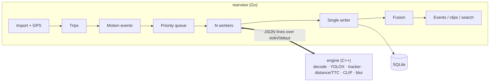

# Rearview

Rearview turns hours of dashcam footage into a searchable list of real driving events (hard braking, close following, tailgating, near-misses), with clips, incident reports and plain-English search, using a concurrent Go orchestrator and a C++ vision engine on the GPU.

| | |
| --- | --- |
| **Hard-brake detection** | precision 1.00, recall 1.00 (9 of 9 labelled brakes; 4.2 h of footage; labels not yet owner-reviewed) |
| **Search** | right moment in the top 5 for 5 of 24 drafted queries (21%; 5.35 h of front footage, 19,266 keyframes) |
| **Speed** | 1 hour of 2560×1440 footage analysed in **2.4 minutes** (RX 9070 XT, DirectML; 28 min on the CPU) |

Near-miss and following-distance detection run end to end, but have no accuracy numbers yet: they need labelled events and a camera calibration ([what's missing](#limitations)). A demo video is planned ([docs/notes/demo-script.md](docs/notes/demo-script.md)).

## What it does

```text
$ rearview import D:\           # copy new recordings off the SD card, read the GPS hidden in each MP4
new 235, skipped 0, failed 0
19 trips
17 motion events

$ rearview process              # detect and track objects on the GPU, distance + time-to-collision
done 235, failed 0 ...

$ rearview events --type hard_brake
ID  TIME                 TYPE        SOURCE  SCORE  TRIP  LOCATION
17  2026-10-25 22:02:46  hard_brake  motion  0.53   17    45.46047,-75.48923
...
$ rearview clip 17              # 15 s clip, stream copy, under a second
$ rearview report 17            # one-page PDF: key frames, speed and G graph, location
$ rearview search "a construction crane"
```

## Architecture



- **Go** ([go/](go/)) owns everything that coordinates or decides: SD-card import with crash-safe copies, an MP4 box parser that decodes the camera's binary GPS blocks, trip assembly, motion events, a priority job queue, a pipeline of worker goroutines (one engine process each) feeding a single database writer, crash recovery and resume, event fusion and scoring, clips, search ranking, reports and benchmarks.
- **C++** ([engine/](engine/)) owns everything that touches pixels: frame decoding with sampling, YOLOX object detection through ONNX Runtime (CPU or DirectML), a ByteTrack-style Kalman tracker, camera calibration, distance and time-to-collision, CLIP image and text encoders with a from-scratch BPE tokenizer, and face/plate blurring.

**Why two languages.** Go's goroutines, channels and `errgroup` make the orchestration (bounded queues, cancellation, restarting a crashed worker, one SQLite writer) short and testable; C++ gives direct control over OpenCV, ONNX Runtime and memory in the hot loop. Running the engine as a child process instead of through cgo keeps the builds independent, lets a crash in native code cost one job retry instead of the whole run, and makes the Go side testable with a fake engine.

**The protocol** ([protocol/README.md](protocol/README.md)): one JSON object per line. Go sends `analyze {path, windows, fps, features}`, `embed_frames`, `embed_text`, `extract_frames`, `blur`, `cancel`, `shutdown`; the engine streams `progress`, `frame {t, objects[]}`, `embedding` and ends each job with `done` (frames, fps, per-stage times) or `error {code}`. A process that dies or stays silent is restarted and the job retried once.

## Results

### Accuracy

| Event | Precision | Recall | Data |
| --- | --- | --- | --- |
| Hard brake (GPS speed drop ≥ 10 km/h in 1 s) | 1.00 | 1.00 | 9 labels, 2026-10-23/24, 4.2 h |
| Swerve | 1.00 | 0.17 | 6 labels, 5 of which sit on GPS heading glitches (under review) |
| Near-miss, following close, tailgated | — | — | no labels yet |

How they were tuned: [docs/notes/2.6.md](docs/notes/2.6.md). The threshold fell from the plan's 14 to 10 km/h only after a filter for the GPS receiver's dropout records (heading exactly 0°, speed briefly 0 at 130 km/h) removed 30 false alarms. A later pass found three more kinds of dropout (all-zero positions, and 0 km/h / 0° records at low speed); three labels drafted from those were artefacts and were removed, which is why there are 9 brake labels and not 12. The labels were drafted from GPS candidates, so these numbers say the detector matches its own candidate list after review; an independent check needs labels from watching the video.

### Search

CLIP ViT-B/32 on one keyframe per second, bottom 22% (hood and camera overlay) cropped off; share of 24 queries with the labelled ±5 s moment in the top 5 ([docs/notes/7.md](docs/notes/7.md)):

| Variant | Hood kept | Hood cropped |
| --- | --- | --- |
| Centre crop, "a dashcam photo of …" | 5/24 (21%) | 3/24 (12%) |
| Centre crop, plain query | 4/24 (17%) | 5/24 (21%) |
| Three crops, "a dashcam photo of …" | 3/24 (12%) | 3/24 (12%) |
| **Three crops, plain query (default)** | 2/24 (8%) | **5/24 (21%)** |

Well below the 70% target. The queries were drafted from contact sheets and each has a single labelled range, while most of them ("white pickup truck", "stop sign") occur dozens of times: a top-5 hit on another real pickup counts as a miss. A fairer test labels every occurrence of a few rare things. Searching 57,798 vectors (19,266 keyframes × 3 crops) takes 0.6–0.8 s including the CLIP text pass, plus 0.2–0.5 s to start the engine and load the index.

### Performance

1 hour of 2560×1440 H.264 front footage, analysed at 10 fps with detection, tracking, distance and TTC ([bench/set.txt](bench/set.txt), [docs/notes/6.md](docs/notes/6.md)):

| Change | Minutes per hour of footage | Speedup |
| --- | --- | --- |
| CPU baseline (7800X3D, 2 workers × 4 threads)¹ | 28.0 | 1.0× |
| GPU inference: ONNX Runtime + DirectML on the RX 9070 XT¹ | 2.9 | 9.7× |
| 2 engine workers¹ | 2.5 | 11.2× |
| Same, threaded decode/preprocess inside the engine off¹ | 3.0 | 9.3× |
| Hardware decoding (D3D11VA) instead of CPU decoding¹ | 6.4 | 4.4× (rejected) |
| **Final, full 62-min set (repeat run within 1.7%)** | **2.4** | **11.7×** |

¹ on the first 15 minutes of the set. Inference went from 53 to 3 ms per frame; decoding and resizing 1440p frames (8 + 6 ms) are now the bottleneck.

## Build and run

Windows 11 with Visual Studio 2022, CMake, vcpkg, Go 1.27, ffmpeg (`scripts/setup-windows.ps1` checks or installs them).

```powershell
cmake -P engine/scripts/download_models.cmake          # YOLOX-s, CLIP, YuNet (SHA-256 checked)
cd engine; cmake --preset dev-dml; cmake --build --preset dev-dml; ctest --preset dev   # dev for CPU only
cd ../go; go build -o bin/rearview.exe ./cmd/rearview; go test ./...
```

Point `~/rearview/config.yaml` at the engine (`engine: {path: ..., device: dml}`), then `rearview import <SD card>`, `rearview process`, `rearview process --embed`, and explore with `events`, `clip`, `search`, `trips --score`, `report`, `export --blur`, `bench`. Every command has `--help`.

## Repository

| Path | Contents |
| --- | --- |
| [go/](go/) | `rearview` CLI and packages (`mp4gps`, `ingest`, `trips`, `prefilter`, `queue`, `engine`, `pipeline`, `fusion`, `search`, `report`, `bench`, `store`), the fake engine for tests |
| [engine/](engine/) | C++20 engine (`decode`, `detect`, `track`, `geometry`, `embed`, `blur`, `protocol`), GoogleTest suite |
| [protocol/](protocol/) | the Go ↔ engine message spec |
| [docs/plan/](docs/plan/) | the build plan, decisions log and results |
| [docs/notes/](docs/notes/) | a walkthrough of every core task |
| [testdata/](testdata/) | three 20-s test clips (Git LFS), GPS golden files, labels, tokenizer golden ids, search queries |

## Limitations

- **Small dataset**: 5.35 hours of one camera in one city over four days; 15 labels, all from a GPS-suggested candidate pass. Final numbers on the held-out day (2026-10-25) need labels for that day.
- **Distance is uncalibrated**: until the checkerboard calibration and tape-measure test ([docs/notes/calibration-howto.md](docs/notes/calibration-howto.md)) are done, distance assumes a 100° pinhole lens, so following-distance events are indicative only. TTC doesn't depend on calibration.
- **No near-miss labels**, so no precision/recall for near-miss, following and tailgating.
- **No accelerometer** in this camera: G-forces are derived from 1 Hz GPS speed.
- **Plates are blurred by region, not detected**: the lower-middle of every vehicle box is blurred.
- The camera burns its own overlay (speed, GPS, its plate) into every frame.
- MIGraphX through Windows ML was not built; DirectML is in maintenance mode.

## Licence

MIT ([LICENSE](LICENSE)). Models keep their own licences: YOLOX (Apache-2.0), CLIP (MIT), YuNet (MIT).
