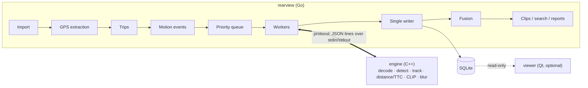

# Design

How Rearview is put together: the parts and who owns what, the stack, the repo layout, the features, the core math, the thresholds and how it is tested. The database schema is in [data-model.md](data-model.md) and the Go ↔ engine messages in [protocol/README.md](../protocol/README.md).

## Architecture

Three parts: a Go orchestrator that plans and records the work, a C++ engine that analyses pixels, and an optional Qt viewer that reads the results. Rule of thumb: if it looks at pixels or runs a model, it's C++; if it coordinates, stores or decides, it's Go.



Each worker goroutine drives its own engine process, so an engine crash costs one retry, not the whole run. All database writes go through one goroutine.

| Part                      | Language    | Owns                                                                                                                  | Never does                                              |
| ------------------------- | ----------- | --------------------------------------------------------------------------------------------------------------------- | ------------------------------------------------------- |
| Orchestrator (`rearview`) | Go          | Import, GPS, trips, motion events, scheduling, engine processes, fusion, clips, database, search ranking, reports, CLI | Decode video or run models                              |
| Engine (`engine`)         | C++20       | Decoding, preprocessing, YOLOX, CLIP, face detection, tracking, distance and TTC, blur, frame extraction             | Write to the database or decide what counts as an event |
| Viewer (`viewer`)         | C++ with Qt | Playback, event timeline, map, overlays, search box (through the CLI)                                                 | Write anything (read-only)                              |

## Stack

**Go** (`go/go.mod`): `spf13/cobra` (CLI), `charmbracelet/bubbletea` + `lipgloss` (progress view), `fsnotify`, `golang.org/x/sync/errgroup`, `modernc.org/sqlite` (pure Go, no C compiler needed), `go-pdf/fpdf` (incident PDFs), `gopkg.in/yaml.v3` (config), `go-cmp` (tests).

**C++** (`engine/vcpkg.json`, vcpkg baseline pinned): OpenCV 4 (decoding, resizing, drawing, calibration, blur), FFmpeg libraries (optional D3D11VA hardware decoding), Eigen (Kalman filter), nlohmann/json (protocol), GoogleTest. ONNX Runtime comes from Microsoft's prebuilt releases, SHA-256 pinned in [engine/cmake/onnxruntime.cmake](../engine/cmake/onnxruntime.cmake): the CPU build 1.31.1, or the DirectML build 1.24.4 with the `dev-dml` preset.

**Viewer** (`viewer/vcpkg.json`): Qt 6 base (Widgets, SQL, Network) and Qt Multimedia on the Windows Media Foundation backend.

**Tools**: ffmpeg / ffprobe (clips, probing), exiftool (test oracle for the GPS decoder only).

**Models** (pretrained exports, no training; fetched with checksums by `cmake -P engine/scripts/download_models.cmake` into `engine/models/`):

| Model                                                                 | Used for                                                  | Licence    |
| --------------------------------------------------------------------- | --------------------------------------------------------- | ---------- |
| YOLOX-s (Megvii 0.1.1rc0)                                             | Cars, trucks, buses, people, bikes, motorcycles, lights   | Apache-2.0 |
| CLIP ViT-B/32 image and text towers (`Xenova/clip-vit-base-patch32`) | Plain-English search; tokenizer vocab and merges from OpenAI | MIT        |
| YuNet 2023mar (OpenCV zoo)                                            | Faces for the privacy blur                                | MIT        |

There is no plate detector: plates are blurred as a region of each vehicle box.

## Repository layout

```
rearview/
├── .github/            AGENTS.md (rules for coding agents), workflows/ci.yml
├── protocol/           README.md: the Go <-> engine message spec
├── go/
│   ├── cmd/rearview/   the CLI
│   ├── cmd/fakeengine/ a fake engine for tests (canned replies, crash or hang on demand)
│   ├── examples/       runnable Go primer examples (docs/walkthroughs/go-primer.md)
│   └── internal/
│       ├── config/     paths, file-name patterns and every threshold
│       ├── ingest/     stable-size check, hash, crash-safe copy, ffprobe
│       ├── mp4gps/     MP4 box walker + freeGPS decoder
│       ├── trips/      clock fix, front/rear pairing, trips, GPS gap filling, GPX
│       ├── prefilter/  hard brakes and swerves from GPS, priority windows
│       ├── labels/     ground-truth label file
│       ├── eval/       precision / recall against labels
│       ├── queue/      job planner and priority queue
│       ├── engine/     engine process client and worker (restart + retry)
│       ├── pipeline/   workers + single writer (errgroup + channels), progress stats
│       ├── fusion/     near-miss, following-close and tailgated events from observations
│       ├── clips/      ffmpeg wrapper
│       ├── search/     keyframe index and ranking
│       ├── report/     driving score and incident PDF
│       ├── bench/      benchmark runner
│       └── store/      SQLite access; migrations/ (never edited after merge)
├── engine/
│   ├── src/            core, decode, detect, track, geometry, pipeline, embed, blur, debug, protocol, main.cpp
│   ├── tests/          GoogleTest
│   ├── cmake/          ONNX Runtime download
│   ├── scripts/        download_models.cmake
│   └── models/         ONNX files (gitignored)
├── viewer/             optional Qt 6 desktop app
├── testdata/           clips/ (3 × 20 s, Git LFS), gps/ (golden files), labels/events.csv, tokens/, search_queries.csv
├── bench/              set.txt (benchmark footage list), results/ (one JSON per run)
├── scripts/            setup-windows.ps1, backup-footage.ps1 (+ Pester tests)
└── docs/               this file, data model, walkthroughs/, plan/, write-up, demo script, interview prep
```

Never committed (gitignored): footage, `engine/models/`, build outputs, the SQLite database.

Runtime paths (overridable in `~/rearview/config.yaml`): library `~/rearview/library/`, database `~/rearview/rearview.db`, clips `~/rearview/clips/`, camera calibrations `~/rearview/calibration/`.

## Features

| #   | Feature                  | Go                                                                                    | C++                                                                 | Status                                                                      |
| --- | ------------------------ | ------------------------------------------------------------------------------------- | ------------------------------------------------------------------- | --------------------------------------------------------------------------- |
| A   | Footage library, import  | Stable-size check, hash, crash-safe copy, tag camera / locked / parking               | —                                                                   | Done: re-import adds 0 rows                                                 |
| B   | GPS extraction           | MP4 box walk, freeGPS decode, knots → km/h, glitch filtering                          | —                                                                   | Done: matches exiftool within 1e-5° and 0.1 km/h                            |
| C   | Trips                    | Gaps, front/rear pairing, clock fix, summaries, GPX                                   | —                                                                   | Done                                                                        |
| D   | Motion events            | Hard brakes and swerves from GPS; priority windows                                    | —                                                                   | Done: hard brakes P/R 1.00 on 9 labels; no accelerometer in this camera     |
| E   | Detection and tracking   | Choose files, windows, frame rate                                                     | Decode, letterbox, YOLOX, NMS, Kalman tracker                       | Done                                                                        |
| F   | Near-miss (TTC)          | Fuse TTC with braking, score, merge                                                   | Box-growth TTC per in-path track                                    | Runs; needs labels for precision/recall                                     |
| G   | Following distance       | Following time = distance ÷ GPS speed                                                 | Distance from box height and calibration                            | Runs; needs a calibration and tape-measure test                             |
| H   | Clips                    | ffmpeg stream copy, joins across files, side-by-side                                  | —                                                                   | Done: 0.2 s warm                                                            |
| I   | Plain-English search     | Vector index, ranking, grouping into moments                                          | CLIP image/text encoders, BPE tokenizer                             | Done: 21% top-5 on 24 drafted queries                                       |
| J   | Privacy blur             | `export --blur`                                                                       | YuNet faces, vehicle plate regions, held boxes                      | Done; needs a frame-by-frame check                                          |
| K   | Driving score            | Per-trip score with a breakdown, weekly trend                                         | —                                                                   | Done                                                                        |
| L   | Incident PDF             | Layout, speed and G graph, map position                                               | Exact frame extraction                                              | Done                                                                        |
| M   | CLI and progress view    | cobra commands, bubbletea progress screen                                             | —                                                                   | Done: every command has `--help` and a test                                 |
| N   | Performance              | Scheduling, `bench` with history                                                      | DirectML inference, threaded pipeline, optional hardware decoding   | Done: 2.4 min per hour of footage                                           |
| O   | Desktop viewer           | —                                                                                     | Qt: video + overlays, timeline, map, search                         | Done                                                                        |

## The core math

Time-to-collision from how fast a tracked box grows, using the tracker's smoothed height $h$ and its rate $dh/dt$. For an object at distance $d$ closing at $v$, $h \propto 1/d$, so $(dh/dt)/h = v/d$:

$$
\mathrm{TTC} \approx \frac{h}{\,dh/dt\,}
$$

Distance from box height with focal length $f$ (pixels) and a per-class real height $H$ (car 1.5 m, truck 2.0 m, bus 3.2 m, person 1.7 m):

$$
d \approx \frac{f \cdot H}{h}
$$

Following time, with $v$ the GPS speed in m/s:

$$
t_{\text{follow}} = \frac{d}{v}
$$

## Thresholds

All in the config file (`rearview config show`); these are the current defaults.

| Event           | Rule                                                                                                                  |
| --------------- | --------------------------------------------------------------------------------------------------------------------- |
| Hard brake      | Speed drops 10 km/h or more within 1 s (tuned from 14; see [phase 2](walkthroughs/phase-2-motion-events.md))          |
| Swerve          | Heading changes 30° or more within 1 s, above 30 km/h                                                                 |
| Near-miss       | TTC under 1.5 s for 3+ consecutive analysed frames, box at least 40 px tall, bottom-centre inside the path trapezoid |
| Following close | Following time under 1.0 s for 3 s or more, above 50 km/h, object in the path                                         |
| Tailgated       | The same rule on the rear camera                                                                                      |

## Testing and evaluation

Tests prove the code is correct and run on every PR; evaluations prove the results are good and run when a model, threshold or the scheduler changes.

| Layer               | What it checks                                                      | Where                                                  |
| ------------------- | ------------------------------------------------------------------- | ------------------------------------------------------ |
| Go unit tests       | Parsers, detectors, queue order, fusion rules, scoring, CLI commands | Next to each package (`go test ./...`)                 |
| Go race tests       | No data races in the pipeline                                       | `go test -race ./...` in CI (needs cgo)                |
| Golden files        | GPS decoder vs exiftool, tokenizer ids                              | `testdata/gps/`, `testdata/tokens/`                    |
| Pipeline tests      | Worker pool, crash and hang recovery, cancel, resume                | `internal/pipeline`, `internal/engine`, with the fake engine |
| C++ unit tests      | Letterbox, NMS, Kalman, tracker ids, TTC, distance, calibration, BPE, blur, server | `engine/tests/` (`ctest`)                |
| Accuracy evaluation | Precision and recall per event type against labels                  | `rearview eval --type ...`; results in [plan/decisions.md](plan/decisions.md) |
| Search evaluation   | Correct moment in the top 5                                         | `rearview eval --search`                               |
| Benchmarks          | Minutes per hour of footage, per-stage times                        | `rearview bench`; `bench/results/`                     |

Rules that keep the numbers honest: a held-out day (2026-10-25) is never used for tuning; a match counts only within 3 s and with the same type; `eval` is re-run after every performance change; every number is reported with its dataset size.
