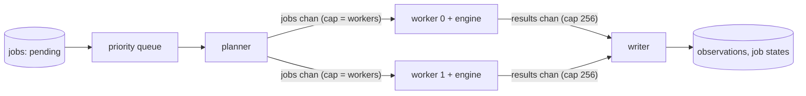

# 4.5 Pipeline wiring and 4.6 resume: walkthrough

## Shape ([pipeline.go](../../go/internal/pipeline/pipeline.go))

- **errgroup** runs the planner, the N workers and the writer; any of them returning an error cancels the shared context.
- **Planner** pops in priority order into a jobs channel only `workers` deep, so a priority-0 job pushed late doesn't wait behind a long backlog.
- **Workers** each own one `engine.Worker` (one engine process) for the whole run. Per job they send `started`, every intermediate reply, `reset` if the engine was restarted, and finally `done`, `failed` or `interrupted` (context cancelled). `defer w.Close()` shuts the engine down when the jobs channel closes.
- **Closing results.** A `sync.WaitGroup` counts the workers; a goroutine waits on it and then closes `results`, so the writer's `range` ends only after the last worker can no longer send. Closing it anywhere else risks a send on a closed channel.
- **Writer** is the only goroutine that writes to SQLite during a run (SQLite allows one writer; WAL lets readers continue). It buffers observations per job and commits them in batches of 2,000 in one transaction, which is far faster than a commit per row. It uses `context.Background()` so a cancelled run can still mark jobs correctly. After an error it keeps draining `results` so workers never block.

## Job state and resume (4.6)

| Event                                    | Writer does                                                 |
| ---------------------------------------- | ----------------------------------------------------------- |
| `started`                                | `state = running`, `attempts + 1`                           |
| `reset` (engine restarted for the retry) | delete the job's observations so far                        |
| `done`                                   | flush buffer, `state = done`, `engine_fps`                  |
| `failed`                                 | delete partial observations, `state = failed`, `last_error` |
| `interrupted` (Ctrl+C)                   | delete partial observations, `state = pending`              |

A hard kill (Task Manager, power loss) leaves jobs `running` with some observations already committed. `Run` starts with `db.ResetRunning`: each such job loses its observations and goes back to `pending` in one transaction, then runs again. Every job's observations are therefore exactly one complete attempt.

## Tests ([pipeline_test.go](../../go/internal/pipeline/pipeline_test.go)) and real runs

- 100 jobs on 4 workers: 100 done, exactly 1,000 observations, work spread over the workers. Passes under `go test -race` in CI.
- Engines crashing on every second job: all jobs done, no rows from crashed attempts.
- Failing engine: failures recorded with `last_error`.
- Cancel after 0.7 s, then a fresh run: done counts add up to 20, 200 observations, no duplicates, nothing left `running`.
- Simulated hard kill (job running with a stray row): the row is gone, `attempts = 2`.
- Real footage: `rearview process --only-windows` analysed 30 event windows (3,031 frames) in 3.5 min. A full run killed with `taskkill /F` after 75 s left 2 jobs `running` with 4,001 rows; the next start reset them (0 rows at 8 s, attempts 2), and after a second hard kill there were 0 duplicate `(job, t, track)` rows.
