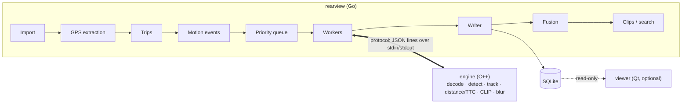

# Architecture

Three parts: a Go orchestrator that plans and records the work, a C++ engine that analyzes pixels, and an optional Qt viewer that reads the results. Rule of thumb: if it looks at pixels or runs a model, it's C++; if it coordinates, stores or decides, it's Go.

Footage flows through the Go stages. Each worker drives its own engine process over the protocol link ([protocol/README.md](../../protocol/README.md)), so an engine crash costs one retry, not the whole run.

| Part                      | Language    | Owns                                                                                                          | Never does                                              |
| ------------------------- | ----------- | ------------------------------------------------------------------------------------------------------------- | ------------------------------------------------------- |
| Orchestrator (`rearview`) | Go          | Import, GPS, trips, motion events, scheduling, engine processes, fusion, clips, database, search ranking, CLI | Decode video or run models                              |
| Engine (`engine`)         | C++         | Decoding, preprocessing, YOLOX, CLIP, face and plate detection, tracking, distance and TTC, blur              | Write to the database or decide what counts as an event |
| Viewer (optional)         | C++ with Qt | Playback, event timeline, map, overlays                                                                       | Write anything (read-only)                              |
