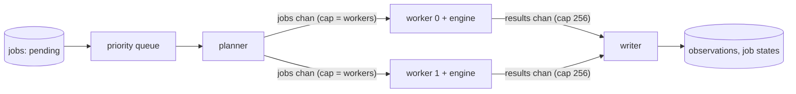

# Phase 4: connecting Go and the engine

The engine's protocol server, the Go client, the job planner and queue, and the worker pipeline with crash recovery and resume.

## 4.1 Engine server loop

### What it does

`engine serve [--models dir] [--device cpu] [--threads n] [--conf 0.3] [--nms 0.45]` loads YOLOX once, prints `ready`, then reads one JSON command per line from stdin and streams replies on stdout until `shutdown` or end of input. [`protocol::Server`](../../engine/src/protocol/server.h) is independent of the models: commands are dispatched to `Handler` functions, so tests plug in a fake one.

### Core logic ([server.cpp](../../engine/src/protocol/server.cpp))

- **Two threads.** A reader thread parses stdin lines; the main thread runs jobs one at a time from a queue. This is what lets `cancel` arrive while a long `analyze` is busy.
- **Reader.** Invalid JSON, or no integer `id` / string `cmd`, gets `error bad_request` straight away. `cancel` never enters the queue: it adds `target_id` to a set of cancelled ids and, if that job is running, sets the atomic flag the analyzer checks before every frame. `shutdown` cancels the running job and closes the queue. End of input (Go died) behaves like `shutdown`.
- **Job start.** The flag is re-armed from the cancelled set, so a `cancel` that arrives before its job starts still works.
- **Replies.** [`Emitter`](../../engine/src/protocol/server.cpp) writes a whole line under a mutex and flushes after every message, because Go reads line by line. `JobEmitter` adds the job's `id`. On Windows stdout is switched to binary mode so `\n` is not turned into `\r\n`.
- **Errors.** `AnalyzeError` carries a protocol code (`file_not_found`, `decode_failed`, `bad_request`); `std::bad_alloc` becomes `out_of_memory`; a JSON type error in the command is `bad_request`; anything else is `internal`. Unknown commands get `unknown_command`.
- **`ping`** answers `pong` (added to the spec in this task; the plan listed no reply for it).
- **`analyze`** ([handlers.cpp](../../engine/src/protocol/handlers.cpp)) validates path, windows (`end > start`), fps and features, then runs the [analyzer](../../engine/src/pipeline/analyzer.cpp), sending `frame` for frames with objects, `progress` about once a second, and `done` with per-stage times.

### Tests ([server_test.cpp](../../engine/tests/server_test.cpp))

Commands fed through an `istringstream` in place of stdin: ready → pong → frame → progress → done; `error file_not_found` for a missing file and `unknown_command`; a cancel queued before its job makes it end with `cancelled: true` and no frames; bad JSON, missing id and missing cmd; argument parsing; and the real analyzer returning `file_not_found`.

## 4.3 Engine client

### What it does

[`engine.Client`](../../go/internal/engine/client.go) is one running engine process. [`engine.Worker`](../../go/internal/engine/worker.go) wraps it with restart-and-retry. The fake engine ([go/cmd/fakeengine](../../go/cmd/fakeengine/main.go), task 4.2) speaks the same protocol and can be slow (`-delay`), fail (`-fail code`), go silent (`-silent-after n`), crash (`-crash-after n`), ignore cancels or announce another version.

### Core logic

- **Start.** `exec.Command` (not `CommandContext`: the client decides how the process ends), stdin/stdout pipes, stderr forwarded to the run's `engine.log` with a `[worker n]` prefix. Wait for `ready` up to `ReadyTimeout` (2 min: MIGraphX compiles models on first start); a different `protocol_version` kills the process and fails with `ErrVersion`.
- **Reading.** One goroutine scans stdout into a buffered channel of lines; it closes the channel at EOF. `cmd.Wait` runs only after that goroutine finishes, because `Wait` closes the pipe and would otherwise lose the last lines. When the process is killed, a `stop` channel lets the reader drop lines nobody will read, so it can never block forever.
- **`Run(ctx, job)`** writes the command with a fresh id and returns a channel of replies for that id, closed after the final one (`done`, `error`, `pong`). A pump goroutine selects on:
  - a new line: reset the hang timer, decode, forward if the id matches;
  - the hang timer (`job_timeout_s`; the engine sends progress every second): kill, report `hung`;
  - stdout closed: report `died`;
  - `ctx.Done()`: send `cancel` once, then give the engine 2 s to answer `done` before killing it.
- **`Do`** drains `Run` and turns the ending into a Go error: `*EngineError` for protocol errors, `ErrDied`, `ErrHung`, or `ctx.Err()`.
- **Retry (`Worker.Do`).** If the error is retryable (`ErrDied`, `ErrHung`, `decode_failed`, `out_of_memory`, as the spec says), the process is killed and restarted, `onReset` tells the caller to throw away the partial results of the first attempt, and the job runs once more. Other errors fail the job immediately.
- **Close** sends `shutdown`, closes stdin and waits 2 s before killing.

### Tests ([client_test.go](../../go/internal/engine/client_test.go))

TestMain builds the fake engine. Normal run with optional fields decoded and the process reused; `file_not_found` not retried; `decode_failed` retried once then reported; crash on the second job retried on a new process (new pid, partial frames reset); crash every time gives `ErrDied`; silence detected after the 1 s timeout and retried; cooperative cancel returns `cancelled: true` within 300 ms and keeps the process; ignored cancel kills it after 2 s; version mismatch; missing binary.

## 4.4 Job planner and priority queue

### Planner ([plan.go](../../go/internal/queue/plan.go))

`queue.Plan` adds `analyze` jobs for segments that have none yet (so re-running `process` never duplicates work):

| Segment            | Jobs                                                                                                                       |
| ------------------ | -------------------------------------------------------------------------------------------------------------------------- |
| Locked (RO folder) | the whole file, priority 0                                                                                                 |
| Has motion events  | the merged event windows (10 s before to 5 s after each, from [2.2](phase-2-motion-events.md#22-priority-windows)), priority 1; the rest of the file, priority 2 |
| Neither            | the whole file, priority 2                                                                                                 |
| Parking            | none                                                                                                                       |

The priority-2 job covers the **complement** of the event windows (`Complement`, slivers under 1 s dropped), so no second of video is analysed twice and observations never overlap. `--only-windows` skips priority 2. A segment's jobs are fixed once planned: events found later don't re-plan it (delete its jobs to force that).

### Queue ([queue.go](../../go/internal/queue/queue.go))

A binary heap (`container/heap`) ordered by priority then id, guarded by a mutex. Rather than a condition variable, `Pop` waits on a `notify` channel that is closed and replaced on every `Push` or `Close`, so it can also `select` on `ctx.Done()`: a blocked `Pop` returns as soon as the run is cancelled. A job pushed later with a better priority is the next one out, which the plan's two-channel pattern can't guarantee.

### Tests ([queue_test.go](../../go/internal/queue/queue_test.go))

Mixed priorities come out 0, 0, 1, 1, 2, 2 with ids in order; a late priority-0 job jumps the line; `Pop` blocks until a push and returns on cancel; complement maths; the planner on four segments (normal with an event, locked, parking, normal) and a second plan adding nothing; `--only-windows`.

## 4.5 Pipeline wiring and 4.6 resume

### Shape ([pipeline.go](../../go/internal/pipeline/pipeline.go))

- **errgroup** runs the planner, the N workers and the writer; any of them returning an error cancels the shared context.
- **Planner** pops in priority order into a jobs channel only `workers` deep, so a priority-0 job pushed late doesn't wait behind a long backlog.
- **Workers** each own one `engine.Worker` (one engine process) for the whole run. Per job they send `started`, every intermediate reply, `reset` if the engine was restarted, and finally `done`, `failed` or `interrupted` (context cancelled). `defer w.Close()` shuts the engine down when the jobs channel closes.
- **Closing results.** A `sync.WaitGroup` counts the workers; a goroutine waits on it and then closes `results`, so the writer's `range` ends only after the last worker can no longer send. Closing it anywhere else risks a send on a closed channel.
- **Writer** is the only goroutine that writes to SQLite during a run (SQLite allows one writer; WAL lets readers continue). It buffers observations per job and commits them in batches of 2,000 in one transaction, which is far faster than a commit per row. It uses `context.Background()` so a cancelled run can still mark jobs correctly. After an error it keeps draining `results` so workers never block.

### Job state and resume (4.6)

| Event                                    | Writer does                                                 |
| ---------------------------------------- | ----------------------------------------------------------- |
| `started`                                | `state = running`, `attempts + 1`                           |
| `reset` (engine restarted for the retry) | delete the job's observations so far                        |
| `done`                                   | flush buffer, `state = done`, `engine_fps`                  |
| `failed`                                 | delete partial observations, `state = failed`, `last_error` |
| `interrupted` (Ctrl+C)                   | delete partial observations, `state = pending`              |

A hard kill (Task Manager, power loss) leaves jobs `running` with some observations already committed. `Run` starts with `db.ResetRunning`: each such job loses its observations and goes back to `pending` in one transaction, then runs again. Every job's observations are therefore exactly one complete attempt.

### Tests ([pipeline_test.go](../../go/internal/pipeline/pipeline_test.go)) and real runs

- 100 jobs on 4 workers: 100 done, exactly 1,000 observations, work spread over the workers. Passes under `go test -race` in CI.
- Engines crashing on every second job: all jobs done, no rows from crashed attempts.
- Failing engine: failures recorded with `last_error`.
- Cancel after 0.7 s, then a fresh run: done counts add up to 20, 200 observations, no duplicates, nothing left `running`.
- Simulated hard kill (job running with a stray row): the row is gone, `attempts = 2`.
- Real footage: `rearview process --only-windows` analysed 30 event windows (3,031 frames) in 3.5 min. A full run killed with `taskkill /F` after 75 s left 2 jobs `running` with 4,001 rows; the next start reset them (0 rows at 8 s, attempts 2), and after a second hard kill there were 0 duplicate `(job, t, track)` rows.
